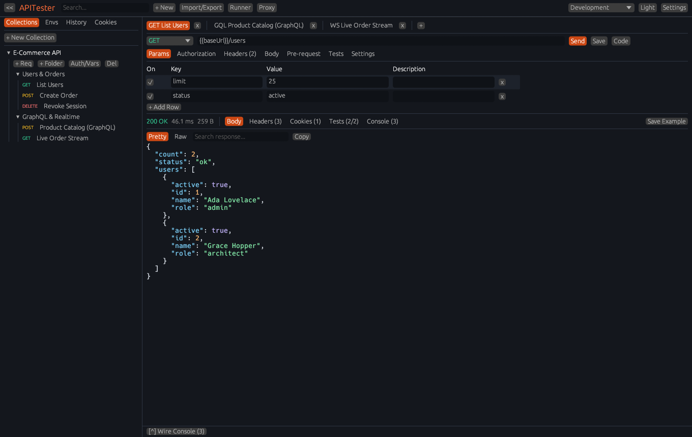
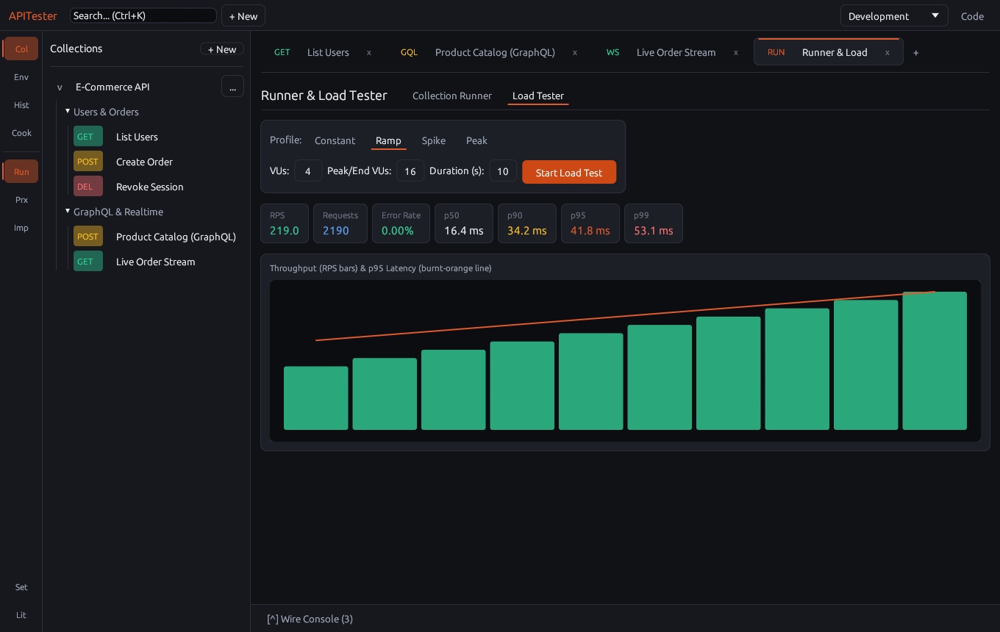
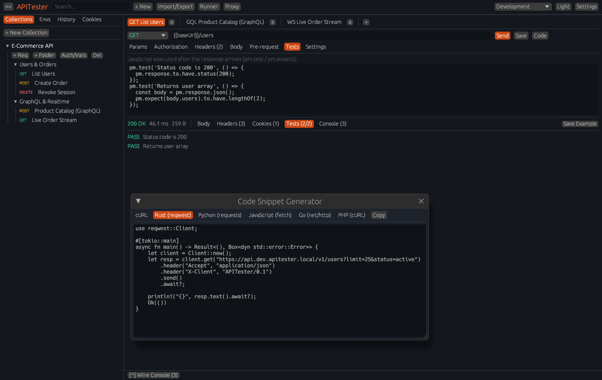

# APITester

A fast, local-first, native Rust API client, collection runner, and load tester built as a lightweight Postman replacement — with zero Electron, zero telemetry, and zero forced cloud login.



## Quick Install (Ubuntu / Linux)

Requires the Rust toolchain ([rustup.rs](https://rustup.rs)) and `git` (no `sudo` required):

```bash
curl -fsSL https://raw.githubusercontent.com/rafadepaula-olist/apitester/main/install.sh | bash
```

To uninstall:

```bash
curl -fsSL https://raw.githubusercontent.com/rafadepaula-olist/apitester/main/install.sh | bash -s -- --uninstall
```

## Features

- **Native GPU-Accelerated GUI (`egui`/`eframe`)**: Multi-tab workbench, Dark & Light themes, color-coded HTTP method/status badges, syntax-highlighted JSON/XML/HTML response viewer with in-response search, and a collapsible Wire Console.
- **Full HTTP/1.1 & HTTP/2 Client**: Params synced with URL, headers, cookies, all body modes (`none`, `raw`, `x-www-form-urlencoded`, `multipart/form-data` with file uploads, `binary`, `GraphQL`), DNS/TTFB/Total timing breakdown, custom TLS client certs, and outbound HTTP/HTTPS/SOCKS5 proxy support.
- **All 13 Postman Auth Types + Inheritance**: `Inherit`, `NoAuth`, `Bearer`, `Basic`, `ApiKey`, `OAuth 2.0` (PKCE, client credentials, password, refresh, local callback server), `AWS SigV4`, `JWT`, `Digest` (RFC 7616), `OAuth 1.0`, `NTLM`, `Hawk`, `Akamai EdgeGrid`, and `ASAP`.
- **Sandboxed QuickJS Scripting (`pm.*`)**: Pre-request and post-response JavaScript scripts via embedded QuickJS (`rquickjs`) with `pm.test`, Chai-style `pm.expect`, `pm.response`, `pm.request`, scoped variables (`Local > Data > Environment > Collection > Global`), and `pm.execution.setNextRequest`.
- **Collection Runner & Native Async Load Tester**: Multi-iteration collection runs with CSV/JSON data files, plus a native Tokio virtual-user load tester (`Constant`, `Ramp`, `Spike`, `Peak` profiles) with p50/p90/p95/p99 latency percentiles and live timeline charting.
- **Realtime & Extra Protocols**: GraphQL (with `__schema` introspection), WebSocket, Server-Sent Events (SSE), gRPC (`.proto` parser + HTTP/2 unary framing), MQTT, Socket.IO v4, and MCP (Model Context Protocol over stdio & HTTP/SSE).
- **Import / Export & Codegen**: Postman Collection v2.1 & Environment import/export, cURL import/export, OpenAPI 3.x / Swagger 2.0 (JSON & YAML), HAR 1.2, and code snippet generation for cURL, Rust (`reqwest`), Python (`requests`), JavaScript (`fetch`), Go (`net/http`), and PHP (`cURL`).
- **Local Capture Proxy**: Built-in HTTP/HTTPS capture proxy with self-signed Root CA generation and one-click "Open as Request".
- **Hybrid Local Storage**: Git-friendly JSON files for Collections & Environments, bundled SQLite for History, Cookies, and Settings, plus OS Keyring vault integration.

| Load Tester | Code Snippet Generator |
| :---: | :---: |
|  |  |

## Performance

Measured on Linux x86_64 release builds (`cargo build --release`):

| Metric | APITester (Rust) |
| :--- | :--- |
| GUI Binary Size (`apitester`) | `33 MB` |
| CLI Binary Size (`apitester-cli`) | `14 MB` |
| CLI Startup / Max RSS | `~20 ms` / `5.0 MB` RSS |
| GUI Full 7-View Render / Max RSS | `~1.4 s` / `103 MB` RSS |
| Load Tester Throughput (4 VUs, local) | `> 4,000 RPS` (`p50 0.87 ms`, `p95 1.62 ms`) |

## Workspace Layout

```text
crates/
├── core/            # Models (Postman v2.1 compatible), {{var}} engine, JSON + SQLite + Keyring storage
├── auth/            # All 13 Postman auth providers + OAuth2 PKCE/callback helpers
├── net/             # Async HTTP/1.1+2, SSE, GraphQL, WebSocket, gRPC, MQTT, Socket.IO, MCP
├── scripting/       # Sandboxed QuickJS (rquickjs) engine implementing pm.* API
├── runner/          # Collection Runner (CSV/JSON) + Native async Load Tester
├── import_export/   # Postman v2.1, cURL, OpenAPI 3 / Swagger 2, HAR 1.2, 6-language codegen
├── proxy/           # Local HTTP/HTTPS capture proxy & Root CA generator
├── ui/              # Native GPU-accelerated desktop app (`apitester`)
└── cli/             # Headless CLI runner (`apitester-cli`, Newman replacement)
```

## Installation (Linux / Ubuntu)

Requires the Rust toolchain (`cargo` / `rustc` via [rustup.rs](https://rustup.rs)).

```bash
./install.sh
```

This builds release binaries and installs to your user directory (no `sudo` required):
- `~/.local/bin/apitester` (GUI)
- `~/.local/bin/apitester-cli` (CLI)
- `~/.local/share/icons/hicolor/scalable/apps/apitester.svg`
- `~/.local/share/applications/apitester.desktop`

To uninstall:

```bash
./install.sh --uninstall
```

## Usage

### Desktop GUI

```bash
apitester                 # Launch normally
apitester --demo          # Launch with sample collections, environments, and responses
```

### Headless CLI (`apitester-cli`)

```bash
# Run a Postman v2.1 or native collection with environment & CSV data
apitester-cli run collection.json --env dev.env.json --data users.csv --iterations 2

# Run a native load test (profiles: constant | ramp | spike | peak)
apitester-cli load https://api.example.com/health --vus 16 --duration 15 --profile ramp

# Import cURL / OpenAPI / HAR / Postman into native JSON
apitester-cli import openapi.yaml --format openapi -o collection.json

# Export a collection to Postman v2.1 JSON
apitester-cli export collection.json -o exported.postman_collection.json

# Generate client code snippets (curl | rust | python | js | go | php)
apitester-cli codegen collection.json --request 0 --lang rust

# Start the local HTTP/HTTPS capture proxy
apitester-cli proxy --bind 127.0.0.1:8888
```

## Building & Testing

```bash
cargo test --workspace
cargo clippy --workspace --all-targets -- -D warnings
cargo build --release
```

## License

[MIT](LICENSE)
